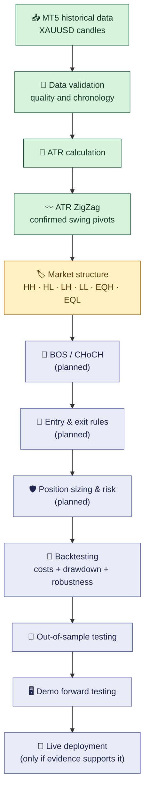
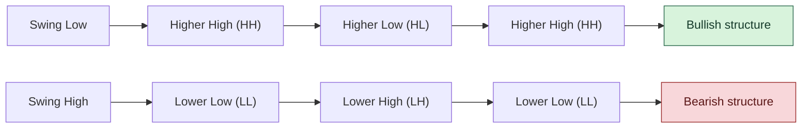

# 🟡 Gold Quant Engine

> **A research-first algorithmic trading project for XAUUSD (Gold).**  
> The goal is to build, test and validate a rule-based trading system before considering demo or live execution.

[](#-project-status)
[](#-project-overview)
[](#-data-and-market)
[](#-getting-started)

---

## 🧭 What does this project do?

The Gold Quant Engine is being developed in stages. It analyses historical Gold price data, identifies market swings, classifies market structure and will eventually test trading signals with realistic risk controls.

**Important:** This is a research project—not a proven profitable strategy or a live-trading bot. A working script does not prove a trading edge.

## 🗺️ How the engine is intended to work



<details>
<summary>🔎 How to read this roadmap</summary>

- 🟢 **Green:** foundational work already implemented and tested to date.
- 🟡 **Yellow:** current development area; still requires refinement and stronger tests.
- 🔵 **Blue:** planned work—not implemented or validated yet.

The diagram is a roadmap, not a claim that every completed component is production-ready.
</details>

## 📊 Current project status

| Component | Status | What it means |
|---|---|---|
| Python environment & project structure | ✅ Set up | Local development environment exists |
| MT5 historical data download | ✅ Implemented | Chunked download of XAUUSD candles |
| Data quality checks | ✅ Passed | Chronology, duplicates and OHLC sanity checks |
| ATR calculation | 🟡 Basic version | Currently a 14-period rolling mean of True Range |
| ATR ZigZag pivots | 🟡 Prototype tested | Several reversal multipliers have been evaluated |
| Market-structure labels | 🟡 Refinement in progress | HH, HL, LH, LL, EQH and EQL |
| BOS / CHoCH | ⏳ Planned | Not implemented yet |
| Entries, exits and risk engine | ⏳ Planned | Not implemented yet |
| Backtesting and robustness | ⏳ Planned | No validated trading edge yet |
| Demo / live trading | 🚫 Not ready | Do not connect this prototype to a live account |

## 📈 Understanding market structure

The engine currently uses swing highs and lows to describe price movement.



| Label | Meaning | Basic interpretation |
|---|---|---|
| **HH** | Higher High | A high above the reference high |
| **HL** | Higher Low | A low above the reference low |
| **LH** | Lower High | A high below the reference high |
| **LL** | Lower Low | A low below the reference low |
| **EQH** | Equal High | A high within the defined tolerance |
| **EQL** | Equal Low | A low within the defined tolerance |

<details>
<summary>🧠 What is an ATR-based ZigZag?</summary>

ATR (Average True Range) estimates recent market volatility. Instead of treating every small price fluctuation as a meaningful swing, the prototype waits for price to reverse by a configurable ATR multiple before confirming a pivot.

For example, with a 2.0 ATR reversal threshold:

- ATR = 3.00 price units
- Reversal threshold = 2 × 3.00 = 6.00 price units
- A pivot is confirmed only after the required reversal is observed.

A pivot has two important timestamps:

1. **Pivot time:** when the extreme price occurred.
2. **Confirmation time:** when enough subsequent price movement confirmed the pivot.

The pivot is not known at its original pivot time. Any future strategy must avoid using it before confirmation; execution should occur no earlier than the next available candle after confirmation.
</details>

## 🧱 Project structure

```text
gold_quant_engine/
│
├── config/
│   └── settings.py              # Symbol, timeframe and model parameters
│
├── data/
│   └── raw/                     # Historical MT5 candle data (CSV)
│
├── strategies/
│   ├── market_structure.py      # Swing and ATR ZigZag detection
│   └── structure_classifier.py  # HH/HL/LH/LL/EQH/EQL labels
│
├── tests/
│   ├── test_pivot_cleaning.py
│   ├── test_pivot_significance.py
│   ├── test_atr_zigzag.py
│   ├── test_zigzag_deep_dive.py
│   └── test_market_structure.py
│
├── backtests/                   # Backtesting work (planned)
├── utils/
│   └── download_data.py         # MT5 historical data downloader
│
└── README.md
```

*The tree reflects the project layout established so far; filenames may evolve as the engine develops.*

## ⚙️ Configuration

Current central settings are maintained in `config/settings.py`:

```python
SYMBOL = "XAUUSD"
TIMEFRAME = "M15"

ATR_PERIOD = 14
ATR_MULTIPLIER = 2.0

EQUAL_LEVEL_TOLERANCE = 0.10
```

These are research parameters, not optimized or proven trading settings. The current ATR implementation uses a simple rolling mean of True Range; the ATR method should be standardized and documented before final strategy evaluation.

## 🚀 Getting started

### 1. Activate the virtual environment (Windows PowerShell)

```powershell
.\.venv\Scripts\Activate.ps1
```

### 2. Run a test from the project root

```powershell
python -m tests.test_atr_zigzag
```

Other test modules can be run in the same way, for example:

```powershell
python -m tests.test_market_structure
```

> Run commands from the `gold_quant_engine` project root so Python can resolve the project packages.

### 3. Data requirements

The current analysis uses the CSV file:

```text
data/raw/XAUUSD_M15.csv
```

The existing M15 dataset contains 100,000 candles and ends on **26 August 2026**. Refresh the historical data before relying on it for current-market research or forward testing.

## 🧪 Research principles

This project follows a few non-negotiable rules:

- **No look-ahead bias:** a signal must only use information available at that time.
- **No cherry-picking:** evaluate across different market conditions and unseen data.
- **Include trading costs:** spread, commission, swaps and slippage can turn a theoretical edge into a losing strategy.
- **Control risk:** position sizing, stop-loss logic and drawdown limits must be tested—not assumed.
- **Keep a research record:** document parameter changes and compare results against a baseline.
- **Do not rush live deployment:** historical performance alone is not sufficient evidence.

## 🎯 Next milestones

- [ ] Finish and test the market-structure classifier, including equal-level drift cases.
- [ ] Add synthetic tests for edge cases and confirmation timing.
- [ ] Implement and validate BOS and CHoCH detection.
- [ ] Define entry, exit and invalidation rules.
- [ ] Build position sizing and risk controls.
- [ ] Backtest with realistic costs and robust performance metrics.
- [ ] Run out-of-sample and walk-forward tests.
- [ ] Forward-test on a demo account.
- [ ] Consider live deployment only after the evidence justifies it.

---

## 🤝 Contributing / understanding the code

If you are reviewing this repository, start with:

1. `config/settings.py` — understand the active parameters.
2. `utils/download_data.py` — see how historical candles are retrieved.
3. `strategies/market_structure.py` — inspect swing and ATR ZigZag logic.
4. `strategies/structure_classifier.py` — inspect how pivots are labelled.
5. `tests/` — see what has actually been tested.

**The guiding principle:** build a trading system that can survive rigorous testing—not one that merely produces attractive signals.
